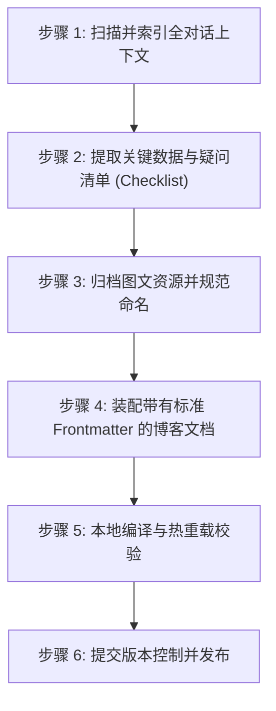

# 基于技术对话提炼技术博客 Skill (Dialogue to Blog Skill)

本 Skill 专门用于指导 AI 编程助手将一段**真实发生的人机交互对话、技术调试记录、问题探索全过程**，提炼并转化为一篇具备高工程价值、深度技术原理、全量细节覆盖且**完全没有 AI 腔调**的专业技术博客。

---

## 核心定位与设计哲学

普通 AI 在写文章时极易陷入两大通病：
1. **脱离实际交互凭空编造**：抛弃对话中真实的报错、硬件参数、折腾波折，生成泛泛而谈的“科普八股文”；
2. **语言浮夸且严重概括**：充斥着“颠覆性”、“划时代”、“深入探讨”等空话套话，并在细节处偷懒，使用“等等”、“诸如此类”将核心讨论一笔带过。

**本 Skill 的核心设计哲学：**
* **对话即骨架**：真实发生的每一次终端执行、报错排查、用户的每一次发问、质疑和反驳，才是最具技术价值的内容。
* **现象与原理成对**：拒绝模糊叙述。每一个小节必须明确回答两个问题：**“当时遇到的情况/疑问是什么？”** 与 **“背后的具体底层技术原理和机制是什么？”**。
* **绝对全覆盖**：讨论了几个点，就必须老老实实写全几个点，严禁擅自删减、合并或弱化任何一个技术细节。

---

## 四大核心写作铁律

### 1. 真实历程还原原则（对话即大纲）
* 严格遵循人机交互的真实逻辑演进展开（如：从最开始的硬件物理接入 -> 发现状态异常 -> 逐步排查授权 -> 抓取屏幕 -> 深入到系统内核机制探讨 -> 权衡硬件与平台差异）。
* 保留对话中出现的真实参数（如机型代码、SoC 平台型号、内存具体数值、电压毫伏、温度数值、具体终端命令与返回值），拒绝使用占位符模糊化。

### 2. “疑问是什么 + 具体底层原理是什么”的双栏/成对范式
在展开讨论与技术剖析章节，所有子标题与小节必须保持统一的工程解析结构：
* **【疑问/情况】**：清晰、准确地复述用户在对话中提出的具体技术疑问或遇到的现象；
* **【技术原理/机制】**：从操作系统内核、硬件总线、网络协议、运行时虚拟机（如 ART/JVM）、编译器或安全策略（如 DAC/MAC、AVB、TEE）的底层运行机制入手，给出严谨、准确、成体系的技术原理解答。

### 3. 点对点绝对全覆盖（严禁擅自删减或概括）
* **清单对齐**：若在对话中讨论了 6 个核心疑问，文章中必须严格呈现为 6 个独立二级/三级标题；
* **子项穷尽**：若在对话中阐述了某个特权的 6 项具体能力（如 Root 的 6 大作用），文章正文中必须按序完整展开 6 点，每一项均须写明具体调用的底层接口与工作机制，严禁合并为 3 点或用“等等”草草收尾。

### 4. 平实叙述，彻底去除 AI 腔调与浮夸修辞
* **禁用词清单**：
  * 严禁出现公关与营销式词汇：`颠覆性`、`划时代`、`不可否认的是`、`毋庸置疑`、`在当今数字化浪潮中`、`让我们拭目以待`、`深入浅出`、`大放异彩`；
  * 严禁出现空洞的总结模板：`总而言之，未来的发展充满机遇与挑战`、`只要我们拥抱变化`；
* **提倡文风**：
  * 使用冷静、客观、直接陈述事实与因果逻辑的工程师语言；
  * 说明事实、列出数据、分析源码、对比机制。

---

## 标准执行流程 (SOP)



### 步骤 1：扫描并索引全对话上下文
在接收到“整理博客”指令后，首先通读本次会话的全部历史轮次，提取以下三类要素：
1. **真实硬件与操作数据**：设备名称、VID/PID、芯片型号、系统版本号、终端执行的核心命令；
2. **所有的提问与反驳点**：机主每一次发问、质疑、反驳（如：“不是接了云端模型吗？”、“Windows 不是也能跑吗？”）；
3. **生成的临时资产**：截屏图片、生成的图表、代码片段。

### 步骤 2：建立全覆盖 Checklist
在落笔撰写前，在模型思考链中列出本次对话覆盖的技术清单。
* 检查是否有任何在聊天中提及的论据、观点、硬件对比、历史先例在草稿中被遗漏。
* 确保每个疑问都有明确的“疑问定义”和“底层原理解析”。

### 步骤 3：图文资源归档与规范命名
若对话中产生了屏幕截图或用户提供了现场照片：
1. 将图片从临时路径转移至博客工程的静态资源目录（如 `src/assets/` 或 `public/`）；
2. **规范命名**：使用全部小写、短横线分隔的 kebab-case 英文语义化命名（例如：`realme-gt8-adb-hardware-specs-terminal.png`），严禁保留含空格和时间戳的原始乱码名；
3. 在 Markdown 对应章节插入标准引用语法，并提供详实客观的图片说明（Alt Text）。

### 步骤 4：装配带有标准 Frontmatter 的博客文档
根据目标博客框架（如 Astro、Hexo、Hugo、VitePress）的规范，配置头部元数据：
```yaml
---
title: '平实且具备具体指向性的技术文章标题'
description: '一句话完整概述文章的技术背景、涉及设备、核心技术点与总结'
pubDate: 'YYYY-MM-DDTHH:MM:SS+08:00'
category: '开发' # 或对应的分类
type: 'ai-organized'
heroImage: '../../assets/xxx.png' # 可选项
---
```
* 正文不重复第一级 H1 标题，从导语段落直接进入“一、 过程还原”与“二、 核心技术疑问深度解析”。

### 步骤 5：本地编译与热重载校验
1. 启动或验证本地开发服务（如 `npx astro dev`）；
2. 通过命令行检查页面编译状态（如 `curl -sIL http://localhost:4321/...`），确保返回 HTTP 200；
3. 校验渲染后 HTML 中的标题、图片标签和字数统计，确保无语法报错或渲染截断。

### 步骤 6：版本控制与现场清理
1. 仅将生成的文章及对应图片加入 Git 暂存区（避免误提交未关联的草稿或个人文件）；
2. 按照用户指定的时间戳或规范生成提交信息（Commit Message）；
3. 彻底删除调试过程中在工作区或脑区遗留的一起性临时文件，保证环境整洁。

---

## 质量自查清单 (Publish Checklist)

在宣布交付前，对照以下清单进行最终闭合验证：
* [ ] **无 AI 套话**：全文是否检索不出“不可否认”、“毋庸置疑”、“颠覆性”、“深入浅出”等禁忌词？
* [ ] **疑问全覆盖**：用户在聊天中提出的每一个具体问题是否都有独立章节且无一遗漏？
* [ ] **列表无截断**：讨论中列举的多项技术机制是否完整呈现，没有使用“等等”、“诸如此类”？
* [ ] **硬件与指令真实**：是否完整保留了真实的终端命令、内核属性、芯片型号与测量数据？
* [ ] **格式严谨**：代码块是否明确标注了语言高亮（`bash`, `text`, `yaml`）？
* [ ] **链接可访问**：本地预览 URL 是否已验证畅通？
